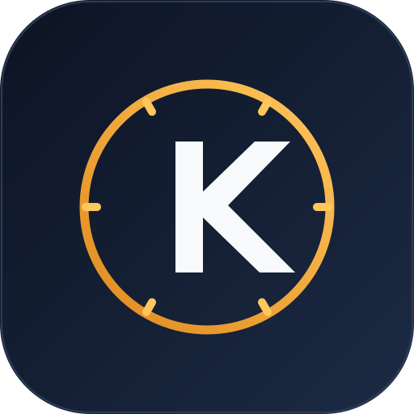
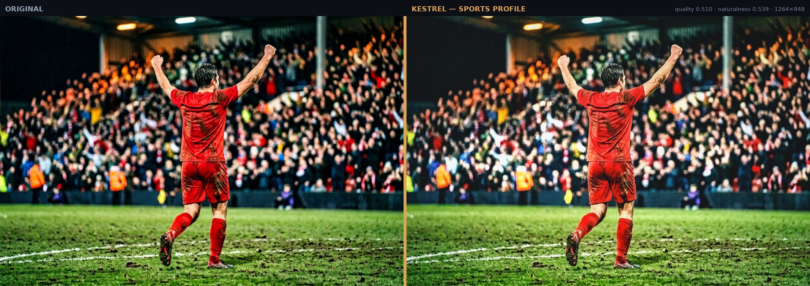

<div align="center">



# Kestrel

**AI photo finishing for Adobe Lightroom Classic.**
*Sports-first. Explainable. Local.*

[](CHANGELOG.md)
[](pyproject.toml)
[](lightroom/Kestrel.lrplugin)
[](tests)
[](#requirements)
[](#privacy)

[Quick start](#quick-start) · [Install](#installation) · [Lightroom setup](#lightroom-classic-setup) · [How it works](#how-kestrel-thinks) · [Docs](#documentation) · [Limits](#honest-limits)

</div>

---

Kestrel is a photo-finishing engine with a Lightroom plug-in and a local web workspace. It looks at each
photograph *before* it touches a slider — genre, lighting, subject, skin, noise, colour cast — decides what that
specific frame needs, writes the result as ordinary, editable develop settings, and tells you why.

It is built for the two hardest jobs in sports photography: a stadium-lit football match shot at ISO 6400, and a
basketball court where the jersey colour, the athlete's skin and the crowd all want different treatment. Every
other genre — wedding, portrait, event, landscape, wildlife, commercial — is handled by the same analysis-first
pipeline with its own targets and its own guardrails.

> **Quality over speed.** Expect roughly 4 seconds per frame at Standard, 12 s at High (the default) and 30 s at
> Maximum on a modern laptop. A 40-frame match takes a coffee. That trade is deliberate and it is the whole point.

<div align="center">

<sub>Night football, ISO-heavy crowd, muddy pitch. Original left — Kestrel sports profile right.
The athlete is lifted without flattening the venue, whites on the advertising boards stay intact, the crowd keeps
its texture instead of turning into mush, and the grass stays green rather than radioactive.</sub>
</div>

---

## Table of contents

1. [Why another editor](#why-another-editor)
2. [What it does](#what-it-does)
3. [Quick start](#quick-start)
4. [Requirements](#requirements)
5. [Installation](#installation) — step by step, every platform
6. [First run](#first-run)
7. [Lightroom Classic setup](#lightroom-classic-setup)
8. [Using Kestrel](#using-kestrel)
9. [How Kestrel thinks](#how-kestrel-thinks)
10. [The web workspace](#the-web-workspace)
11. [Profiles and personalisation](#profiles-and-personalisation)
12. [Batch processing at scale](#batch-processing-at-scale)
13. [Configuration reference](#configuration-reference)
14. [Command line reference](#command-line-reference)
15. [Troubleshooting](#troubleshooting)
16. [Honest limits](#honest-limits)
17. [Performance tuning](#performance-tuning)
18. [Privacy and data](#privacy)
19. [Development](#development)
20. [Documentation](#documentation)
21. [Licence](#licence)

---

## Why another editor

Presets are a single answer applied to a thousand different questions. They cannot know that the frame in front of
them has a face at 2048 K under floodlights, a white jersey at the clipping point, and a background two stops
darker than the subject wants to be.

Kestrel works the other way round:

| | Preset pack | Kestrel |
|---|---|---|
| Decision | fixed sliders | per-photo, from measurements |
| Input | none | genre, light, faces, subject, noise, cast, lens |
| Explanation | no | every adjustment carries a reason |
| Skin | whatever the preset does | measured against a target luminance, protected |
| Batch | identical look | consistent *intent*, individual *values* |
| Failure | silently wrong | reported per frame, with the reason |
| Original | overwritten in place | untouched; snapshot kept for exact revert |

The engine is a decision system with a renderer attached, not a LUT with a GUI. That separation is what makes the
explanations real: the plan is a data structure you can read, log, diff and audit.

---

## What it does

**Analysis** — genre and confidence, indoor/outdoor, night, stadium and artificial light, mixed lighting, backlight,
overcast, crowd/grass/court coverage, faces with sizes and skin regions, subject mask and bbox, exposure
percentiles and clipping, dynamic range, white balance and tint with a confidence figure, colour cast strength,
noise sigma and ISO estimate, sharpness, focus plane, motion blur, lens and camera, compression artefacts.

**Editing** — exposure, contrast, highlights, shadows, whites, blacks, texture, clarity, dehaze, vibrance,
saturation, temperature and tint (clamped, never invented), HSL per colour range, tone curves, sharpening with
edge masking, luminance and colour noise reduction, lens corrections, chromatic aberration removal, defringe,
vignette, grain, and crop suggestions.

**Local work** — subject, background, face, skin, sky, grass, court, crowd, clothing and object masks, plus radial
and linear gradients and brush geometry. Masks carry a confidence value and a delivery capability so you know
exactly what Lightroom will receive natively and what is baked into a rendered file. Click any mask in the editor
and the engine draws it over the photograph — tinted region, white outline — so you can judge it before trusting a
season to it.

**Delivery** — native develop settings written into the catalogue (fully editable afterwards), or a 16-bit TIFF
round trip when a look genuinely cannot be expressed as Lightroom settings. Never both silently.

**Batches** — 1 to 5000+ frames, grouped by lighting so a set stays coherent, processed on a queue that can be
paused, resumed, cancelled and retried, surviving restarts without losing a single completed edit.

**Feedback** — accept, reject, star-rate and manual adjustments are stored locally. With explicit consent they
nudge a small, bounded set of preference weights. No shared model is ever trained on your photographs.

---

## Quick start

Three commands, if you already have Python 3.10+ and a terminal:

```bash
git clone https://github.com/supermario3D1/Lightroom.git
cd Lightroom
python -m venv .venv && source .venv/bin/activate      # Windows: .venv\Scripts\activate
pip install -e .

kestrel serve
```

Then open **http://127.0.0.1:8765/** — that is the workspace. Load the bundled sample with *Load sample gallery*,
or import your own frames.

For Lightroom: **File → Plug-in Manager → Add** and select `lightroom/Kestrel.lrplugin`.

Everything below is the long version, including the parts that usually go wrong.

---

## Requirements

| | Minimum | Recommended |
|---|---|---|
| OS | macOS 12, Windows 10 (21H2), Ubuntu 22.04 | macOS 14, Windows 11, Ubuntu 24.04 |
| Python | 3.10 | 3.11 or 3.12 |
| CPU | 4 cores | 8+ cores |
| RAM | 8 GB | 16 GB or more |
| Disk | 2 GB for the application + library cache | SSD, plus room for exported TIFFs |
| Lightroom | Classic 6.0 (2015) or newer | Classic 12+ |
| GPU | not required | any ONNX Runtime provider (CUDA, CoreML, DirectML) |

Kestrel runs entirely on CPU with calibrated classical computer vision. Optional ONNX models (face detection,
segmentation, denoising) are picked up automatically if they are present in `models/`; the interface tells you
which backends are active rather than pretending.

### Python packages

Installed automatically by `pip install -e .` — no manual step needed:

`numpy`, `scipy`, `opencv-contrib-python-headless`, `scikit-image`, `Pillow`, `rawpy`, `fastapi`, `uvicorn`,
`pydantic`, `python-multipart`, `psutil`.

Optional extras:

```bash
pip install -e ".[onnx]"     # ONNX Runtime — GPU/Metal/CUDA acceleration where available
pip install -e ".[dev]"      # pytest + httpx, for running the test suite
pip install -e ".[all]"      # everything
```

> **Why `opencv-contrib-headless`?** Kestrel is a headless engine with a web UI. The contrib build adds the
> saliency and tracking modules the subject mask uses; headless avoids pulling in a GUI toolkit.

---

## Installation

The instructions below assume a fresh machine. Pick your platform.

### 1 · Get the code

```bash
git clone https://github.com/supermario3D1/Lightroom.git
cd Lightroom
```

If you downloaded a ZIP instead, unzip it and `cd` into the folder — everything works identically.

### 2 · Create an isolated Python environment

<details open>
<summary><b>macOS / Linux</b></summary>

```bash
python3 --version            # must print 3.10 or newer
python3 -m venv .venv
source .venv/bin/activate
python -m pip install --upgrade pip setuptools wheel
```
</details>

<details>
<summary><b>Windows (PowerShell)</b></summary>

```powershell
py -3.12 --version          # must print 3.10 or newer
py -3.12 -m venv .venv
.\.venv\Scripts\Activate.ps1
python -m pip install --upgrade pip setuptools wheel
```

If PowerShell refuses to run the activation script:

```powershell
Set-ExecutionPolicy -Scope CurrentUser RemoteSigned
```
</details>

### 3 · Install Kestrel

```bash
pip install -e .
```

`-e` installs in editable mode, so `git pull` updates the application without reinstalling. A plain
`pip install .` also works and copies the web UI into the package.

### 4 · Verify the install

```bash
kestrel doctor
```

Expected output, with your own hardware values:

```
Kestrel 1.0.0  (release-candidate)
home:      /Users/you/Library/Application Support/Kestrel        (macOS example)
python:    3.12.4
cpu:       Apple M2 Pro × 12 logical cores
memory:    32.0 GB
gpu/onnx:  CPU only
faces:     haar-cascades
...
```

If `kestrel` is "command not found", the virtual environment is not active — re-run step 2 and check that the
prompt starts with `(.venv)`.

### 5 · Choose where the library lives (optional)

By default Kestrel stores its database, caches and renders in a per-user application directory
(`~/Library/Application Support/Kestrel`, `%APPDATA%\Kestrel`, `~/.local/share/kestrel`).

To keep everything in the project folder — convenient for testing, or for a portable install on an external drive:

```bash
export KESTREL_HOME="$PWD/data"          # macOS/Linux
$env:KESTREL_HOME = "$PWD\data"          # Windows PowerShell
```

Use the same variable in every terminal where you run `kestrel`, and point the Lightroom plug-in at the same
engine address (see below). Photographs are never copied into this folder; only the library database, previews
and renders.

### 6 · Install the Lightroom plug-in

See [Lightroom Classic setup](#lightroom-classic-setup). You can skip it and use the web workspace alone.

---

## First run

```bash
kestrel serve
```

```
  Kestrel 1.0.0 — A professional editor's eye, on every frame.
  Local web app:  http://127.0.0.1:8765/
  API:            http://127.0.0.1:8765/api/docs
  Library home:   /Users/you/Library/Application Support/Kestrel
  Photos stay on this machine. No upload happens without your action.
```

Open the URL. The workspace greets you with a short onboarding dialog, then the dashboard.

**Two-minute tour**

1. **Dashboard → Load sample gallery** imports the bundled night-football frame and analyses it.
   *(If the sample is already in your library the import reports it as skipped — that is correct behaviour.)*
2. **Library** shows the frame with its detected genre. Click it.
3. **Editor** → *Edit this photo*. Watch the analysis panel fill in, then the before/after divider appear.
4. Open the **Why** tab: every change is listed with its reason and confidence.
5. **Adjustments** shows the exact develop values, **Local** lists the masks — click one to see exactly what was
   selected — and **Quality** shows the measured score, naturalness and skin error.
6. **Send to Lightroom** builds the delivery packet; **Export…** renders a JPEG or 16-bit TIFF.

Nothing is written over your original file, ever. Re-rendering creates a new version; the history strip keeps
them all.

---

## Lightroom Classic setup

Kestrel ships a real plug-in — not a preset pack. It talks to the local engine over HTTP, applies develop
settings inside a `withWriteAccessDo` block, and keeps a snapshot of the pre-edit settings so *Revert* is exact.

### Install

1. **Start the engine and leave it running.** In a terminal:

   ```bash
   kestrel serve
   ```

   The plug-in needs it for every operation. Closing the terminal stops the engine.

2. In Lightroom Classic: **File → Plug-in Manager**.

3. Click **Add**, navigate to the repository, and select the folder:

   ```
   Lightroom/lightroom/Kestrel.lrplugin
   ```

   Select the **folder**, not a file inside it. On macOS the `.lrplugin` bundle will look like a single item.

4. The plug-in appears in the list as **Kestrel — AI Photo Finishing** with a green **OK**. If it shows an
   error instead, see [Troubleshooting](#troubleshooting).

5. Under the plug-in's panel, click **Engine status**. You should see the version, hardware and capability
   report. If it says the engine is unreachable, the address or the terminal is the problem.

6. **Library → Plug-in Extras → Kestrel** now lists the commands.

### Where the menus are

| Menu location | Command | What it does |
|---|---|---|
| Library → Plug-in Extras | **Edit selected photos…** | Analyse and edit each selected frame, one at a time, with a progress bar |
| Library → Plug-in Extras | **Process in background queue…** | Hand the selection to the engine queue; keep working, or close Lightroom |
| Library → Plug-in Extras | **Edit whole collection…** | The active collection, folder or filmstrip, as one job |
| Library → Plug-in Extras | **Apply latest edit** | Re-apply the stored Kestrel result without re-rendering |
| Library → Plug-in Extras | **Preview and explain** | Analyse and render, show the reasoning, then ask before applying |
| Library → Plug-in Extras | **Compare original / result** | Toggle the exact pre-edit settings against the Kestrel result |
| Library → Plug-in Extras | **Revert to original** | Restore the snapshot taken before Kestrel first touched the photo |
| Library → Plug-in Extras | **Sync look across selection** | Copy the first photo's global develop settings to the rest |
| Library → Plug-in Extras | **Send selection to workspace** | Register frames in the web workspace and deep-link to one |
| Library → Plug-in Extras | **Engine status** | Live version, hardware, library and capability report |
| Library → Plug-in Extras | **Settings…** | Engine address, defaults, snapshot behaviour, record limit |
| Library → Plug-in Extras | **Diagnostics** | Self-test: files, HTTP round trip, schema, preferences |
| Library → Plug-in Extras | **About** | Version and privacy statement |
| File → Plug-in Manager | **Plug-in info panel** | Engine health, quick actions, snapshot count |

### First edit in Lightroom

1. Select one photograph in the Library module (a RAW is ideal).
2. **Library → Plug-in Extras → Kestrel → Edit selected photos…**
3. Choose quality, style, genre override and delivery mode. Press **Edit**.
4. A progress bar shows the frame being analysed and rendered. It will say so plainly if the engine is not
   running.
5. When it finishes you get a summary: frames edited, any failures with their reasons, and the reasoning for the
   first frame.

The photograph now has ordinary develop settings — open the Develop module and every slider is there to adjust.
Kestrel is a starting point you can keep editing, not a black box.

### Delivery modes, and what they mean

| Mode | What happens | Use when |
|---|---|---|
| **Native develop settings** (default) | Global sliders, tone curves, HSL, detail, lens corrections and vignette are written into the catalogue. Masks are reported per-mask in the packet with their capability. | You want everything editable in Lightroom. |
| **Native settings only** | Same, but local masks are ignored entirely. | You want to do your own masking. |
| **Rendered 16-bit TIFF** | The engine renders the finished look at up to 2200 px and imports the TIFF next to the original, leaving the RAW untouched. | The look depends on Kestrel's denoise/deconvolution, or you are delivering to a client. |

The capability table in **Engine status** is generated by the running engine. It states what Lightroom's SDK can
and cannot receive — including that AI-generated subject masks have no documented native API, which is why they are
delivered as a rendered file rather than claimed as a native feature.

### Why the plug-in never freezes Lightroom

Every slow operation runs in a background task with its own cancellable progress bar. The UI thread only ever
builds dialogs and reads the selection. If you cancel, the current frame is abandoned and the completed frames
keep their edits.

### Syncing a set

- **Sync look across selection** copies *global* develop settings. It is the right tool when you have finished one
  hero frame and want the rest to match, and it is honest about one thing: Lightroom's SDK cannot copy local
  masks, so it says so in the confirmation dialog.
- **Process in background queue** is the right tool when you want each frame individually graded. The engine groups
  them by lighting condition and keeps skin, jersey and grass colours consistent across the set.

---

## Using Kestrel

### The workflow it is designed for

1. **Ingest** in Lightroom as usual. Cull.
2. Select the keepers and run **Kestrel → Edit selected photos** (or the background queue for a whole match).
3. Review in Lightroom. Stars and flags still work as you expect.
4. For anything that needs a different look, open it in the workspace, change style or strength, re-render.
5. Deliver: native settings stay in the catalogue; TIFFs land next to the originals.

### Keyboard (workspace editor)

| Key | Action |
|---|---|
| `←` / `→` | Move the before/after divider |
| `B` | Toggle original / 50-50 |
| `Enter` | Re-render with the current settings |
| `A` | Accept |
| `R` | Reject |

---

## How Kestrel thinks

The pipeline is a chain of small, testable stages. Each one can be inspected; the whole chain can be replayed
from the stored analysis.

```
decode ──► analysis ──► clustering ──► decision ──► masking ──► render ──► metrics ──► refine
 (16-bit)   genre, light,   batch         plan: global +            linear      score     up to 3
            faces, noise    consistency   masks + explanation       light                 passes
```

**1 · Decode.** RAW files are decoded at full bit depth (`rawpy`); 16-bit TIFF is read without truncation; JPEG is
treated as what it is. The original file is opened read-only and never written.

**2 · Analysis.** Exposure percentiles, clipping, face boxes and skin samples, subject saliency, scene statistics,
noise sigma, sharpness, lens metadata, colour-cast estimate. Genre is decided from a weighted, gated scoring
function — structural evidence (faces, court, kit colour, crowd) rather than a single keyword.

**3 · Decision.** The genre profile sets targets: tonal placement, contrast character, subject separation, skin
target luminance, noise reduction strength, sharpening amount, crop policy. Measured departures from those targets
become the adjustments. Nothing is applied "because sports" — it is applied because *this* frame is 0.7 EV under
its target with a face at 0.33.

**4 · Masking.** Subject, background, face, skin, sky, grass, court, crowd and clothing masks are generated from the
image. Each carries a confidence. Low-confidence masks reduce their own influence rather than guessing loudly.

**5 · Render.** A linear-light pipeline applies tone, colour and local adjustments, then detail work, then a
highlight-safety pass. Two or three refinement passes at High and Maximum.

**6 · Metrics.** The finished image is measured again — exposure error, clipping, contrast, saturation, skin ΔE,
skin consistency, noise, sharpness, haloing, naturalness. If the result drifts, the plan is corrected and
re-rendered. This is why it takes seconds rather than milliseconds.

**7 · Explanation.** Every stage that moved a value records why. That list is what you read in the **Why** tab, in
the plug-in's summary, and in the exported packet.

### The sports profile in numbers

Sports is the flagship genre, calibrated against real match frames:

| Parameter | Target | Why |
|---|---|---|
| Tonal centre | 0.44 | Stadium frames are dark; lifting to portrait levels flattens the venue |
| Skin target | 0.615, night −0.06 | Floodlit skin sits lower; forcing it brighter is what makes sports edits look plastic |
| Contrast | punchy, controlled | Deep blacks, but protected highlights so white jerseys keep detail |
| Highlights | −30 to −50 | Sweat, white kit and LED boards are the clipping risks |
| Shadows | +20 to +40 | Faces under helmets and caps, without lifting the whole frame into noise |
| Clarity / texture | moderate | Grit without the "dirty face" artefact of over-sharpening |
| Sharpen | 60-ish with ~70 edge masking | Detail on the athlete, no crunchy crowd |
| Luminance NR | floor scaled to measured noise | The crowd should be soft, the subject should not be |
| Subject lift | +0.2 to +0.4 EV masked | Presence, not global exposure |
| Background | −0.1 to −0.3 EV | Separation without turning the venue into a vignette |
| White balance | clamped, confidence-gated | Never bake a guess into a batch |

These are targets the decision layer reasons *from*, not sliders it blindly dials.

---

## The web workspace

The workspace is bundled (no CDN, no build step, works offline) and talks to the same engine the plug-in uses.

| View | What you get |
|---|---|
| **Dashboard** | Library health, queue state, recent imports, delivery capability, quick actions |
| **Library** | Masonry grid, selection with ⌘/Ctrl-click, genre and status badges, import, bulk analyse, bulk edit |
| **Editor** | Large preview with a draggable before/after divider, zoom, style and strength, genre override, profile picker, Why / Adjustments / Local / Quality tabs, clickable mask overlays, edit history strip, feedback, export, Lightroom packet |
| **Batch** | Collection pipeline: genre, style, quality, strength; jobs table with pause, resume, retry, cancel and ETA |
| **Profiles** | 23 built-in profiles plus your own: create, edit, duplicate, delete, import, export |
| **Settings** | Quality and performance, privacy and consent, licence, environment, delivery capability, live log |
| **Guide** | The setup path, Lightroom installation, what is implemented, and the honest limits |

Every control is wired to a real endpoint. There are no placeholder buttons, no fake progress bars and no
simulated AI — if something is not implemented, the interface says so in the Guide and in the capability table.

---

## Profiles and personalisation

Profiles in Kestrel describe **intent**, not sliders:

```jsonc
{
  "name": "Night Football — Broadcast",
  "genre": "sports",
  "subject_emphasis": 0.78,      // how hard the athlete separates from the venue
  "skin_protection": 0.9,        // resistance to over-lifting skin
  "detail_preservation": 0.7,
  "contrast_character": "punchy",
  "colour_character": "warm",
  "advanced": { "grass_boost": 0.3, "crowd_control": 0.6, "wb_tolerance_k": 520 }
}
```

The engine converts that intent into values **for each photograph**. Two frames from the same match get the same
intent and different numbers, because their measurements differ.

Save, rename, duplicate, export and import profiles from the Profiles view (or `kestrel profiles`). Built-ins are
read-only; duplicate one to make it yours.

**Personalisation** is opt-in and deliberately narrow. Accept/reject/rating/manual-adjust events are stored locally
in SQLite. If — and only if — you switch it on, they move a bounded set of preference weights per genre (contrast
±0.22, exposure ±0.20, skin target ±0.035 and so on; the exact caps are exposed in Settings). It cannot train on
your photos, cannot send them anywhere, and can be reset completely at any time.

---

## Batch processing at scale

The queue is designed for a full season, not a demo reel.

- **Per-photo analysis.** Grouping decides the *intent*; each frame still gets its own exposure, subject lift and
  noise reduction.
- **Lighting consistency.** Frames are clustered by measured light so a set does not strobe between looks.
- **Pause, resume, cancel, retry** at any point. Retry only re-runs failed items.
- **Crash safety.** Unfinished items return to the queue on restart; completed versions are already committed and
  are never reprocessed.
- **Progress and ETA** from a rolling average, not a fake timer.
- **Throttles.** Worker count and memory budget are respected; large files are decoded with a bounded edge so a
  5000-frame import cannot exhaust RAM.
- **Background.** Close Lightroom; the engine keeps working. Re-open and run **Apply latest edit** to collect the
  results.

Sizing guide (High quality, 24 MP RAF/CR3):

| Frames | Approx. time | Notes |
|---|---|---|
| 20 | 4 min | single match highlight set |
| 250 | 50 min | a full match |
| 1000 | 3–4 h | a weekend |
| 5000 | 16–20 h | a season; run overnight, pause freely |

Actual timings depend on cores, disk and file size. The workspace shows the measured per-frame time as it runs.

---

## Configuration reference

Settings live in `<home>/config.json` and can be changed in **Settings** or with the CLI. Environment variables
win over the file.

| Setting | Default | Meaning |
|---|---|---|
| `host` | `0.0.0.0` | bind address for the engine (`127.0.0.1` for single-machine only) |
| `port` | `8765` | HTTP port; the plug-in defaults to this |
| `default_quality` | `high` | `standard`, `high`, `maximum` |
| `default_intent` | `automatic` | `natural`, `vibrant`, `dramatic`, `editorial` |
| `max_workers` | 2 | parallel render workers (1–4) |
| `memory_budget_gb` | 4.0 | decode/analysis memory ceiling |
| `personalised_learning` | `false` | opt-in preference learning |
| `allow_cloud` | `false` | no cloud path exists; kept explicit |
| `write_sidecars` | `false` | write analysis JSON next to originals |
| `preserve_input_profile` | `true` | keep the embedded colour profile on export |
| `retention_days` | 365 | how long renders and previews are kept |
| `log_level` | `INFO` | `DEBUG` for support |

| Environment variable | Effect |
|---|---|
| `KESTREL_HOME` | data directory (database, caches, renders, licence) |
| `KESTREL_HOST` / `KESTREL_PORT` | override the bind address |
| `KESTREL_LOG_LEVEL` | override logging |

Quality presets:

| Preset | Analysis edge | Preview edge | Passes | Typical time |
|---|---|---|---|---|
| Standard | 1280 px | 1400 px | 1 | ~4 s |
| High | 1600 px | 1800 px | 2 | ~12 s |
| Maximum | 2048 px | 2200 px | 3 (with deconvolution) | ~30 s |

---

## Command line reference

```bash
kestrel serve                      # start the engine + workspace (Ctrl-C to stop)
kestrel serve --port 9000 --quality maximum
kestrel doctor                     # environment and capability report
kestrel import ~/Photos/Game3      # import a folder or files
kestrel import ~/Photos/Game3 --collection-name "Game 3"
kestrel collections                # list collections
kestrel preview img_abc123         # edit one image, print the reasoning, save a preview
kestrel preview img_abc123 --genre sports --intent dramatic --quality maximum
kestrel batch col_85dd57e97fb1 --quality high --watch
kestrel jobs --watch               # queue status with ETA
kestrel export img_abc123 --format tiff --quality maximum
kestrel eval col_85dd57e97fb1      # run the quality evaluation harness over a collection
kestrel profiles                   # list profiles
kestrel licence-key you@studio.com # vendor-only: issue a signed licence
kestrel --version
```

Every command exits non-zero on failure and prints a message with a suggested next step. `kestrel doctor` is the
first thing to run when anything looks wrong.

---

## Troubleshooting

<details open>
<summary><b>“Kestrel could not reach its local engine”</b></summary>

The plug-in and the workspace both need `kestrel serve` running.

1. Check the terminal: is the process still alive? A closed terminal stops it.
2. Visit http://127.0.0.1:8765/api/health — it should return JSON.
3. If the port is busy, start on another one and tell the plug-in:
   ```bash
   kestrel serve --port 9000
   ```
   then **Plug-in Extras → Kestrel → Settings…** and set the address to `http://127.0.0.1:9000`.
4. Check the address in Settings has no trailing path (`/api` is added automatically).
</details>

<details>
<summary><b>The plug-in does not appear in Lightroom</b></summary>

- Confirm you selected the **folder** `Kestrel.lrplugin` in Plug-in Manager → Add.
- On macOS, right-click the bundle → *Show Package Contents* and check `Info.lua` is directly inside.
- Plug-in Manager should show a green **OK**. A red status tells you which file failed and why.
- Restart Lightroom after adding. Lightroom caches the menu list at startup.
- ZIP downloads sometimes lose the folder structure — re-extract preserving folders.
</details>

<details>
<summary><b>“Lightroom rejected the develop settings”</b></summary>

Kestrel filters every key against a whitelist and clamps values to Lightroom's ranges before writing. If you still
see this:

1. Run **Diagnostics** — it reports whether write access works.
2. Check the photo is not read-only, is not a virtual copy locked by another process, and is not a missing file.
3. Look at the log: `kestrel` logs to `<home>/kestrel.log`; the plug-in logs to Lightroom's own log file
   (**Help → System Info → Show Lightroom Log**).
4. Some very old catalogues reject settings written by newer versions; the plug-in retries with the strict
   whitelist, which drops the offending key and reports it in the summary.
</details>

<details>
<summary><b>RAW files will not import</b></summary>

`rawpy` uses LibRaw. Newer camera bodies need a recent LibRaw:

```bash
pip install --upgrade rawpy
```

If your camera is newer than your LibRaw build, convert to DNG with Adobe DNG Converter first — Kestrel reads DNG
natively. `kestrel doctor` prints the LibRaw version in use.
</details>

<details>
<summary><b>Rendering is slower than the estimates</b></summary>

Expected on 45 MP files, spinning disks, or when `memory_budget_gb` keeps the engine decoding at a reduced edge.
See [Performance tuning](#performance-tuning). If a single frame takes minutes, check that `maximum` quality is
not selected — it runs three passes plus deconvolution.
</details>

<details>
<summary><b>Colours look wrong after export</b></summary>

Kestrel preserves the embedded colour profile by default (`preserve_input_profile`). If you need sRGB for the web,
export JPEG and confirm the viewer is colour-managed. For Lightroom round trips always use **16-bit TIFF** — an
8-bit JPEG will clip the pipeline's precision.
</details>

<details>
<summary><b>“Pipeline could not be opened for writing” (Windows)</b></summary>

Antivirus or OneDrive sync can hold the render directory open. Add the Kestrel home directory to exclusions, or
move `KESTREL_HOME` to a local (non-synced) disk.
</details>

<details>
<summary><b>Reset everything</b></summary>

```bash
kestrel serve --port 8765      # then Settings → Licence / Privacy screens
```

To start from scratch, stop the engine and delete the home directory. **This deletes the library database and all
renders** — your photographs and their Lightroom edits are untouched.

```bash
# macOS
rm -rf ~/Library/Application\ Support/Kestrel
# Windows
rmdir /s "%APPDATA%\Kestrel"
# Linux
rm -rf ~/.local/share/kestrel
```
</details>

Still stuck? Open an issue with the output of `kestrel doctor`, the Diagnostics report and the tail of the log.

---

## Honest limits

No marketing in this section. These are the real constraints, and what to do about each.

| Limit | Why | What you can do |
|---|---|---|
| **Subject masks are classical CV**, not a segmentation network | No pretrained weights ship with the repository, and closed-weight models cannot be redistributed | Masks carry a confidence; review the **Local** tab before batch-applying a season. Drop a compatible ONNX segmentation model into `models/` and it is used automatically |
| **AI denoise and deconvolution are rendered, not native** | Adobe exposes no SDK API for Lightroom's AI Denoise | Use the rendered 16-bit TIFF mode for frames that need it; use native mode for the rest |
| **Local masks are not native Lightroom masks** | The SDK has no documented API for AI masks | Global settings are always native; masks are delivered as a rendered file when they matter |
| **Object removal is not implemented** | Generative fill is out of scope for a non-destructive develop pipeline | Use Photoshop or Lightroom's own healing brush; Kestrel will not ship a dead button |
| **Genre detection can misfire** on unusual frames | A crowd shot with no large face is genuinely ambiguous | Use the genre override in the editor or the batch panel; a collection genre hint biases the whole set |
| **Deep-learning backends are optional** | Shipping model weights would multiply the download and constrain the licence | Without ONNX the engine uses calibrated classical methods and says so in the analysis notes |
| **HDR / panorama merges are out of scope** | Those are Lightroom jobs before editing begins | Merge first, then hand the DNG to Kestrel |
| **Licence keys are offline-verified, not DRM** | Anything running on a customer's machine can be inspected | It keeps honest customers honest and enables seat counts; it is not copy protection |
| **Maximum quality is slow** | Three passes and deconvolution on large files | That is the trade the design chose: quality first, and the quality dial makes it explicit |

Anything labelled *planned* in the [roadmap](docs/ROADMAP.md) is not in the product yet. If a feature is not
implemented, the interface does not offer it.

---

## Performance tuning

- **Start with High.** It is the best quality-to-time point for most work; Maximum mainly helps very large
  prints and heavy crops.
- **Workers.** `max_workers` of 2 is a good default. On an 8-core machine with 16 GB, 3–4 is safe for 24 MP files.
- **Memory.** `memory_budget_gb` caps decode size. If the engine is being killed by the OS, lower it — the engine
  will reduce the analysis edge rather than fail.
- **Disk.** Renders and previews are cached. Put `KESTREL_HOME` on the fastest local disk, and prune old renders
  with `retention_days`.
- **GPU.** `pip install -e ".[onnx]"` enables GPU/CoreML providers where the platform offers them; the engine
  reports which provider it picked in `kestrel doctor`.
- **Batches.** For thousands of frames, use the background queue and let it run. Pause during editing; the queue
  keeps its place.

---

## Privacy

- **Local by default, local only.** The engine binds to your machine. There is no cloud endpoint, no upload, no
  telemetry, no analytics call, not even a version check.
- **Your originals are read-only.** Kestrel opens them for reading and never writes to them.
- **The database knows where your files are** (paths, hashes, metadata) and nothing else leaves the machine.
- **Personalisation is opt-in**, stores bounded weights derived from your explicit feedback, and can be erased
  from Settings in one click.
- **No training on your photographs.** Not silently, not with consent either — the architecture has no path for it.
- **Deletion is real.** Delete a photo from the library and its renders, previews and cached masks go with it.
- **Backups.** The library database is a single SQLite file; `Settings` and the CLI can back it up. Licences and
  the database live in the home directory, so copying that folder backs up the whole state.

---

## Development

```bash
python -m venv .venv && source .venv/bin/activate
pip install -e ".[dev]"

pytest                                   # 131 unit tests
python -m tests.lightroom.lua_harness    # 36 plug-in tests against a live engine
python scripts/brand.py                  # regenerate brand assets
python scripts/sync_web.py               # copy the web UI into the package
```

The plug-in is plain Lua 5.1 and is tested outside Lightroom with `lupa` and mock `Lr*` namespaces — the real
plug-in files run, against a real engine, over real HTTP. See [CONTRIBUTING.md](CONTRIBUTING.md) for the
architecture rules and the review checklist.

Layout:

```
src/kestrel/            engine
  analysis/             scene, faces, subject, quality, exposure, colour, clustering
  decision/             intents and recipes: the plan builder
  render/               masks, linear-light renderer, metrics
  colour/               colour science, profiles, white balance
  lightroom/            native develop-setting mapping and capability report
  profiles/             23 built-in profiles + custom profile library
  personalisation/      bounded preference learning
  queueing/             job queue, grouping, recovery
  library/              SQLite store
  api/                  FastAPI app + bundled web UI
lightroom/Kestrel.lrplugin/   the Lightroom plug-in (Lua)
web/                    workspace source (HTML/CSS/JS, no build step)
tests/                  unit tests + executable plug-in spec
docs/                   PRD, architecture, roadmap, model and dataset notes
scripts/                brand generation, packaging helpers
```

---

## Documentation

| Document | Contents |
|---|---|
| [docs/PRD.md](docs/PRD.md) | product requirements, acceptance criteria, scope decisions |
| [docs/ARCHITECTURE.md](docs/ARCHITECTURE.md) | layering, data flow, module contracts, extension points |
| [docs/ROADMAP.md](docs/ROADMAP.md) | shipped, next, and deliberately out of scope |
| [docs/MODELS.md](docs/MODELS.md) | models used, licences, what is classical and why |
| [docs/DATASETS.md](docs/DATASETS.md) | data strategy, consent, what is never used |
| [docs/UI_UX.md](docs/UI_UX.md) | interface principles, screen inventory, accessibility |
| [docs/TEST_STRATEGY.md](docs/TEST_STRATEGY.md) | test pyramid, evaluation harness, release gates |
| [docs/SPORTS_REFERENCE.md](docs/SPORTS_REFERENCE.md) | the calibration study behind the sports profile |
| [docs/LIGHTROOM_SDK.md](docs/LIGHTROOM_SDK.md) | SDK research notes and the API contract used |
| [CHANGELOG.md](CHANGELOG.md) | release history |
| [CONTRIBUTING.md](CONTRIBUTING.md) | how to build, test and contribute |
| [SECURITY.md](SECURITY.md) | threat model and reporting |

---

## Licence

Kestrel is commercial software. See [LICENSE](LICENSE) for the full terms — evaluation is free, commercial use
requires a licence, and the source is provided for auditability and local extension.

Adobe, Lightroom and Photoshop are trademarks of Adobe Inc. Kestrel is an independent product and is not
affiliated with or endorsed by Adobe.

<div align="center"><sub>
Built for photographers who would rather explain a frame than guess at it.
</sub></div>
